<!--
  Profile README for github.com/developersshammad
  Theme: AMOLED black, silver text, one ice-blue accent (#9CC8FF), matching my portfolio.
  The animated SVGs in /assets are generated (text converted to paths), so they look the same on every device.
-->

  

  

  
  
  
  

  <a href="#about"><b>About</b></a> &nbsp;·&nbsp;
  <a href="#tech-stack"><b>Tech stack</b></a> &nbsp;·&nbsp;
  <a href="#featured-work"><b>Featured work</b></a> &nbsp;·&nbsp;
  <a href="#more-builds"><b>More builds</b></a> &nbsp;·&nbsp;
  <a href="#github-stats"><b>Stats</b></a>

## About

  

I work on both sides of a website: the responsive interface people see, and the **PHP, MySQL and .NET** systems that make it do something. Most projects start with the data; once I know what needs storing and how people will find it, I design the pages around it and add interaction where it genuinely helps.

## Tech stack

  

  
  
  
  

## Featured work

<table>
  <tr>
    <td width="50%"></td>
    <td width="50%"></td>
  </tr>
  <tr>
    <td width="50%"></td>
    <td width="50%"></td>
  </tr>
  <tr>
    <td width="50%"></td>
    <td width="50%"></td>
  </tr>
</table>

The first three are live. Click any card to open it.

## More builds

| Project | What it is | Built with |
|---|---|---|
| **Abyss** | Scroll dive to 10,935 m with a live depth gauge and torch-lit deep-sea animals | GSAP · ScrollTrigger · Canvas · SVG |
| **Solenne** | Product page for a fictional watch that comes apart in 3D as you scroll | GSAP · CSS 3D · SVG |
| **Beatgrid** | 16-step drum machine, every sound synthesised live | Web Audio API · Canvas |
| **Flowfield** | Generative art studio with seeded Perlin noise and PNG export | Canvas · JavaScript |
| **StockRoom** | Inventory system with stock movements and low-stock alerts | PHP 8 · MySQL · PDO |
| **LinkLite** | URL shortener with click analytics and SVG charts | PHP 8 · MySQL |
| **Clinic Booking API** | REST API with slot booking and double-booking protection | C# · ASP.NET Core 8 · EF Core |
| **Expense Tracker** | Windows app for spending against a monthly budget | C# · WinForms · .NET 8 |
| **Pulse Admin · SeatPick · Invoicely** | Dashboard, cinema booking and invoice generator | Bootstrap 5 · Chart.js · JavaScript |
| **QuizCraft · Kanban Flow · TypeRush** | Quiz app, task board and typing test | JavaScript · Canvas |

## GitHub stats

  
  

  

  <!-- Generated daily by .github/workflows/snake.yml into the "output" branch -->
  

  

